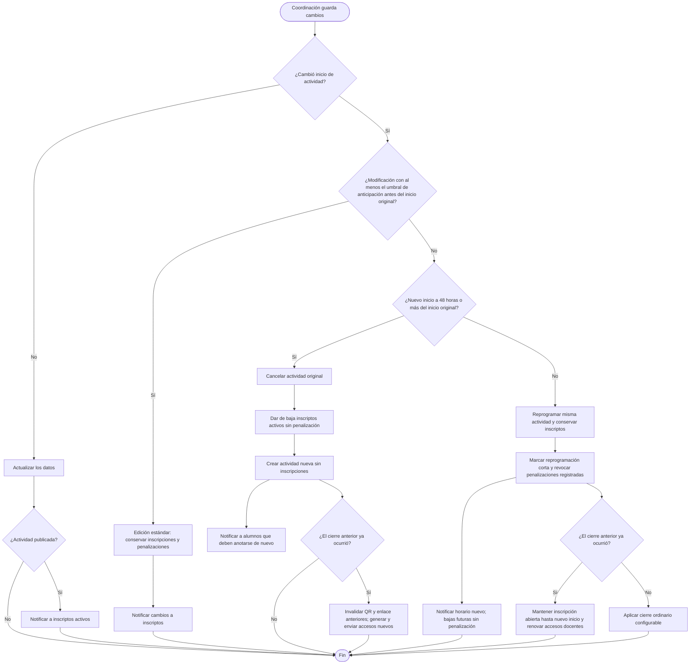
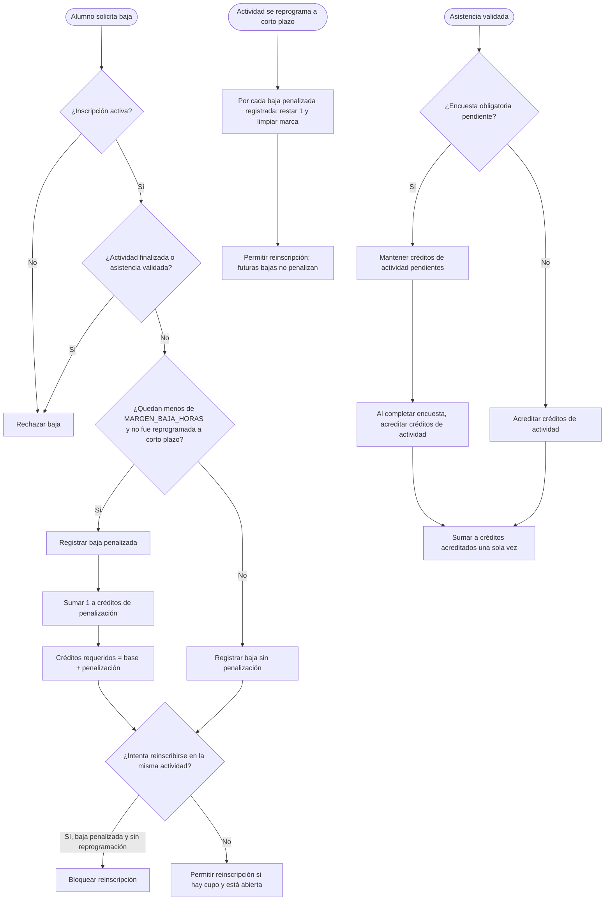

# Instructivo: edición, reprogramación e inscripción

Este documento describe las reglas implementadas para editar actividades y
gestionar inscripciones, bajas, penalizaciones y accesos de asistencia.

## Configuración

Los umbrales se leen al iniciar la aplicación desde variables de entorno o
`.env`. Si no están definidas, se usan estos valores:

| Variable | Default | Uso |
|---|---:|---|
| `MARGEN_BAJA_HORAS` | `24` | Una baja con menos horas restantes penaliza, excepto tras reprogramación corta. |
| `CIERRE_INSCRIPCIONES_HORAS` | `1` | La inscripción ordinaria cierra este número de horas antes del inicio. |
| `UMBRAL_REPROGRAMACION_HORAS` | `48` | Diferencia mínima entre inicio anterior y nuevo para cancelar y republicar. |
| `UMBRAL_ANTICIPACION_REPROGRAMACION_DIAS` | `5` | Anticipación mínima para considerar un cambio una edición estándar. |

Los valores deben ser enteros no negativos. Un valor vacío usa el default; un
valor inválido detiene la carga de configuración con error. `.env.example`
contiene los valores sugeridos. No se debe versionar el `.env` local con secretos.

## Clasificación al editar

Se compara el inicio nuevo con el inicio original, ambos normalizados a UTC.
`fecha_modificacion` es la hora actual del servidor.

1. **Sin cambio de inicio:** no hay clasificación de fecha; la actividad se
   actualiza con el flujo normal.
2. **Edición estándar:** si `fecha_modificacion <= inicio_original - 5 días`
   (umbral configurable), se actualizan los datos, se conservan inscripciones y
   penalizaciones registradas, y se notifica a los inscriptos.
3. **Cancelar y republicar:** si no es edición estándar y
   `inicio_nuevo >= inicio_original + 48 horas`, se marca la actividad original
   como cancelada, se pasan sus inscripciones activas a baja sin penalización y
   se crea una actividad nueva con los datos del formulario. No se copian
   inscripciones. Se avisa a los alumnos que deben anotarse en la actividad
   nueva.
4. **Reprogramación corta:** si no es edición estándar y
   `inicio_nuevo < inicio_original + 48 horas`, se actualiza la misma actividad,
   conservando las inscripciones activas. Se marca como reprogramada, se avisa
   a los inscriptos y sus bajas no reciben penalización.

Los límites son inclusivos donde se indica `<=` o `>=`. Cambiar solo el fin de
la actividad no activa estas reglas de clasificación de inicio.

## Modificación después del cierre

El caso se detecta si se cambia el inicio antes del inicio original y la hora
actual ya alcanzó el cierre ordinario de inscripción.

- Una reprogramación corta extiende la inscripción hasta el nuevo inicio:
  queda abierta mientras `inicio_nuevo > ahora`.
- Se invalidan las credenciales de asistencia anteriores: código QR, enlace
  de cierre manual y sesiones de asistencia. Se genera un QR y enlace nuevos.
- Se reenvía al docente el roster de inscriptos activos con los nuevos accesos.
- Si no se puede enviar algún correo, la respuesta de administración informa
  cuántos fallaron.

Si la edición resulta en cancelar y republicar, la actividad nueva no hereda
inscripciones. Si el cierre de la actividad anterior ya había ocurrido, se
renuevan los accesos para la actividad nueva y se envía su roster vigente
(inicialmente vacío).

## Inscripciones y bajas

- Solo se inscribe en actividades publicadas y con cupo. El cupo se verifica
  bajo bloqueo de la actividad para serializar inscripciones concurrentes.
- El cierre ordinario se aplica cuando falta menos o igual que
  `CIERRE_INSCRIPCIONES_HORAS`. Para una reprogramación corta, se permite
  inscribirse hasta el nuevo inicio.
- Una baja es penalizada si quedan estrictamente menos de
  `MARGEN_BAJA_HORAS`, la actividad no finalizó y no fue reprogramada a corto
  plazo. En el límite exacto del margen, la baja no penaliza.
- La penalización suma un crédito requerido y queda registrada en la
  inscripción de esa actividad.
- Una baja penalizada bloquea reinscribirse a esa misma actividad. No bloquea
  otras actividades. La reprogramación revoca las penalizaciones trazables de
  esa actividad y permite reinscribirse; las bajas posteriores a esa
  reprogramación no penalizan.
- La baja no está disponible si ya finalizó la actividad o si el alumno tiene
  asistencia validada.
- La republicación crea otro ID: los registros históricos de la actividad
  cancelada permanecen en la entidad anterior; los alumnos pueden anotarse en
  la entidad nueva si su inscripción está abierta.

## Notificaciones y asistencia

- Los avisos de cambio a los alumnos son notificaciones y correos para los
  inscriptos activos. Los avisos ordinarios de actualización son best-effort.
- El job de cierre envía a docentes el roster activo, el código de asistencia
  y el enlace para cerrar la ventana.
- En una renovación post-cierre se rotan el código QR y el enlace de cierre,
  se eliminan sesiones anteriores y se restablece el estado de cierre manual.
- Los fallos de SMTP se registran como fallos de entrega; no se considera
  enviado un correo que `send_email` no pudo entregar.

## Diagramas de flujo

### Edición de actividades

### Bajas y créditos

## Pruebas

Las pruebas enfocadas de inscripción, actividades, asistencia y discovery
cubren umbrales, reglas de penalización, republicación y rotación de accesos.
Las pruebas de endpoints de administración cubren actualización y
republicación.
